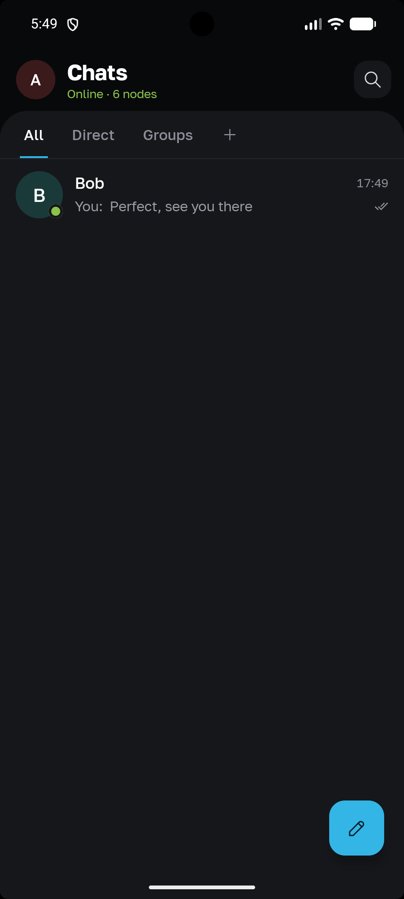
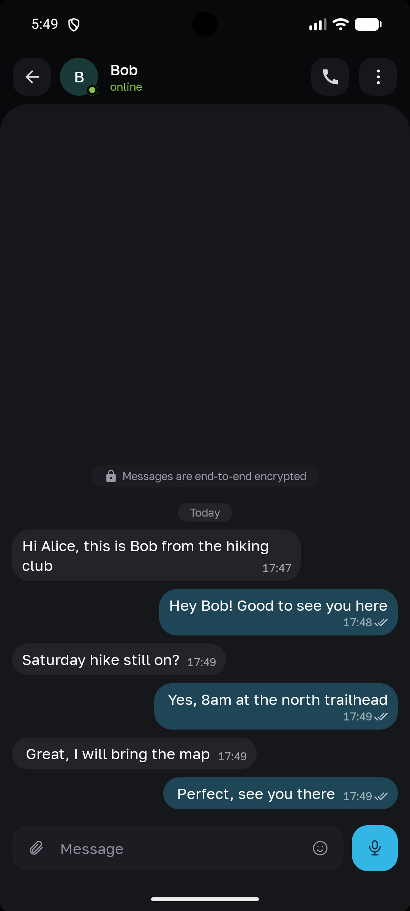
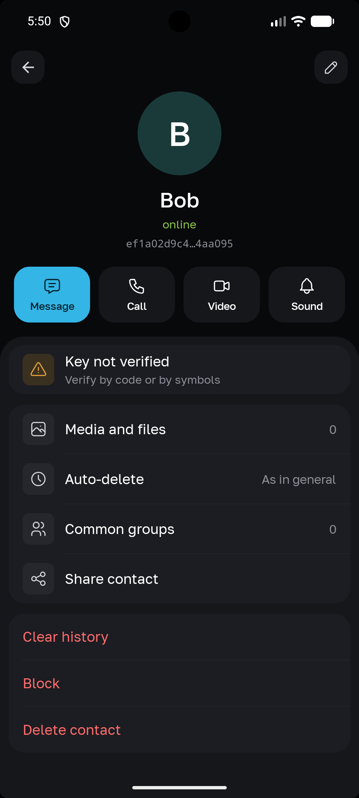
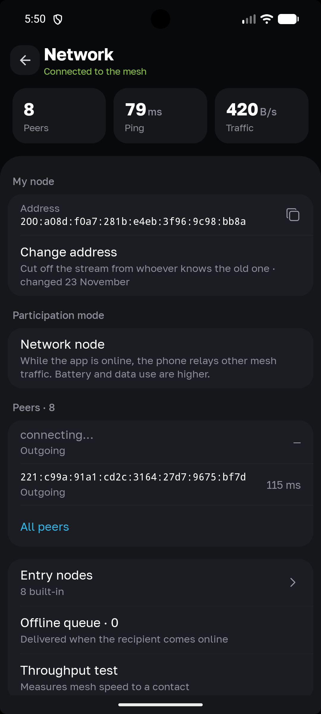
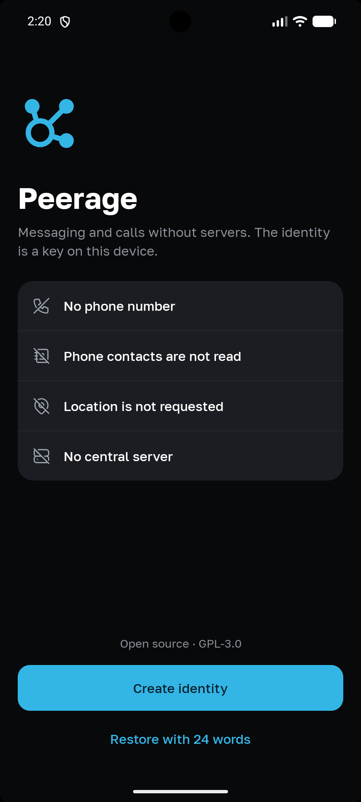
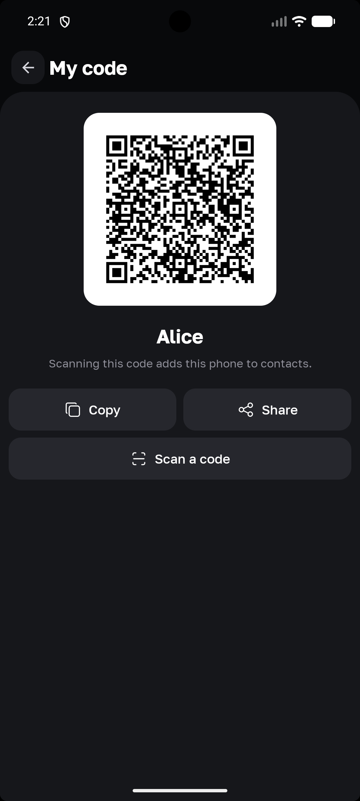
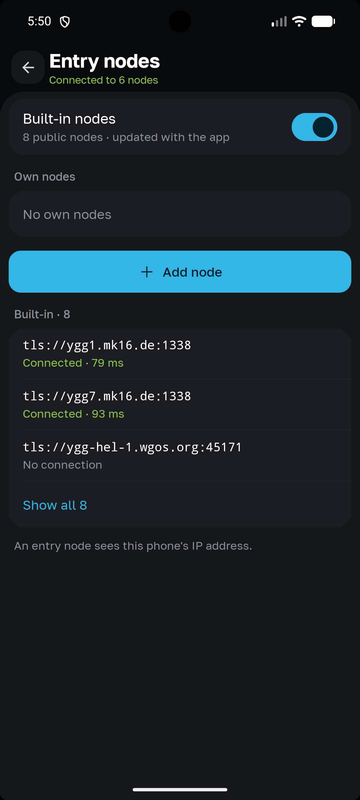

<div align="center">

# Peerage

**A messenger without servers.** Phones talk to each other directly over the
[Yggdrasil](https://yggdrasil-network.github.io/) mesh. There is no account, no phone number
and no server of ours in the data path. Everything is end-to-end encrypted.

[](LICENSE)


[](https://github.com/peerage-chat/peerage/releases)

</div>

<table>
  <tr>
    <td></td>
    <td></td>
    <td></td>
    <td></td>
  </tr>
  <tr>
    <td></td>
    <td></td>
    <td></td>
    <td></td>
  </tr>
</table>

## Status: beta

Peerage is in **public beta**. Direct and group chats, offline delivery, images, files,
voice messages, voice and video calls, backups and search work and are covered by tests.
Some parts have been checked only on an emulator. What is verified, how, and what is
broken: **[docs/project-state.md](docs/project-state.md)**.

> [!WARNING]
> The code has **not had an external security audit**. The design and our own audits are
> in [docs/SECURITY.md](docs/SECURITY.md). Do not rely on Peerage where a mistake would put
> someone in danger.

Until v1.0 the wire format may change between versions. When it does, the release notes
say so, and both sides need the new version.

## What is different

- **No servers at all.** Delivery, the offline queue and file transfer happen between the
  devices themselves. If the two sides are never online at the same time, the message
  waits on the sender's phone and goes out when the other side appears.
- **Contacts by code, not by phone number.** A contact is added by scanning a QR code or
  pasting an exchange code. The first message is a request with a greeting that the other
  side accepts or declines. Strangers cannot write otherwise.
- **MLS groups without a server.** Members are added and removed with real revocation and
  key rotation ([RFC 9420](https://www.rfc-editor.org/rfc/rfc9420)).
- **Attachments from the other phone.** Files arrive in BLAKE3-verified chunks directly
  from the sender. EXIF and GPS data are stripped before sending. Large downloads wait for
  a tap.
- **The receiver sets the limits.** Every peer gets a rate and storage budget by trust
  level. Floods are dropped before decryption.
- **Size padding.** Text, images, files and voice look the same on the wire. A call invite
  looks like an acknowledgement.
- **Own entry nodes.** The phone joins the mesh through public nodes built into the app,
  through nodes the user adds, or both.
- **Honest limits.** What Peerage does not protect against (metadata, timing, quantum
  adversaries, multiple devices) is written down in the
  [threat model](docs/architecture/threat-model.md).

## Install

Android 7.0 or newer on an arm64 phone.

1. Download `peerage-<version>-arm64-v8a.apk` from the
   [releases page](https://github.com/peerage-chat/peerage/releases) (the newest one is on
   top; beta releases are marked as pre-releases).
2. Check the signing certificate before the first install (below).
3. Open the APK on the phone and allow installing from this source.

Updates install over the previous version as long as they are signed with the same key.
Android checks that on every update. Only the first install needs a manual check.

### Check the signing certificate

Every release lists the SHA-256 fingerprint of the signing certificate. With the Android
SDK build tools:

```sh
apksigner verify --print-certs peerage-<version>-arm64-v8a.apk
```

The `certificate SHA-256 digest` line must match this fingerprint (it is also in every
release's notes):

```
04ca852072eb8de62c748e6edbecfb6c6005c759296166f8c013450f41a7cca2
```

If it does not match, do not install the file.

### Updates with Obtainium

[Obtainium](https://github.com/ImranR98/Obtainium) installs and updates apps from GitHub
releases:

- **Source URL:** `https://github.com/peerage-chat/peerage`
- **APK filter:** `arm64-v8a\.apk$`
- **Include prereleases:** on (beta releases are pre-releases)

Each release also carries `update.json` (version, file hash, certificate fingerprint). The format is in [docs/release.md](docs/release.md). The app does not check
for updates by itself: a request to GitHub would reveal the IP address and the fact of
using Peerage.

## Report a bug

Open an [issue](https://github.com/peerage-chat/peerage/issues) with:

- the app version (Profile → About) and the phone model;
- what happened and what was expected;
- steps to reproduce, if known.

**Profile → About → Save log** writes a diagnostic log. It contains no message text, names
or keys. Read it before attaching.

Security vulnerabilities go privately, not into issues. See
[docs/SECURITY.md](docs/SECURITY.md).

## Documentation

| Document | What |
|---|---|
| [docs/project-state.md](docs/project-state.md) | What works, how it was verified, what is broken |
| [docs/ARCHITECTURE.md](docs/ARCHITECTURE.md) | The system end to end: crates, transport, crypto, delivery, media, Android |
| [docs/protocol-spec.md](docs/protocol-spec.md) | Wire protocol and the engine ↔ client contract |
| [docs/SECURITY.md](docs/SECURITY.md) · [threat model](docs/architecture/threat-model.md) | Security goals, audits and findings, guarantees and non-goals |
| [docs/release.md](docs/release.md) | Versions, releases and the `update.json` format |
| [docs/adr/](docs/adr/) | Architecture decision records |
| [docs/README.md](docs/README.md) | Index of all documents |

Some internal documents (design, plans, bug notes) are in Russian.

## Building

The Rust core and the Go wrapper around yggdrasil-go build on Linux (WSL on Windows).

```sh
scripts/build-apk.sh           # signed APK for phones → peerage-arm64.apk
scripts/build-apk.sh x86_64    # for the emulator → peerage-x86_64.apk
scripts/test-all.sh            # the whole Rust test suite (from Linux/WSL)
```

`build-apk.sh` runs from Linux or from Git Bash on Windows (the native part goes through
WSL). It rebuilds both native libraries for the ABI, builds the release APK with Gradle and
signs it with the Android SDK debug key, or with your own key via `PEERAGE_KEYSTORE` (see
the script header).

Releases are built from a tag in a clean Docker container by `scripts/release.sh`, so
anyone can rebuild a release and compare it with the published APK. See
[docs/release.md](docs/release.md) and [reproducible/README.md](reproducible/README.md).

Toolchain: Rust 1.95+, Go 1.24+, Android NDK r28c + cargo-ndk, Gradle 8.9 + JDK 21.
Details: [ARCHITECTURE.md §10](docs/ARCHITECTURE.md#10-build-and-development).

## How it is built

The code is written with AI assistance (Anthropic's Claude, via Claude Code) under the
direction of the maintainer, who makes the architecture and product decisions and tests on
devices. Commits carry a `Co-Authored-By` trailer naming the model.

## Star history

<a href="https://star-history.com/#peerage-chat/peerage&Date">
  <picture>
    <source media="(prefers-color-scheme: dark)" srcset="https://api.star-history.com/svg?repos=peerage-chat/peerage&type=Date&theme=dark">
    
  </picture>
</a>

## License

[GPL-3.0-only](LICENSE).
